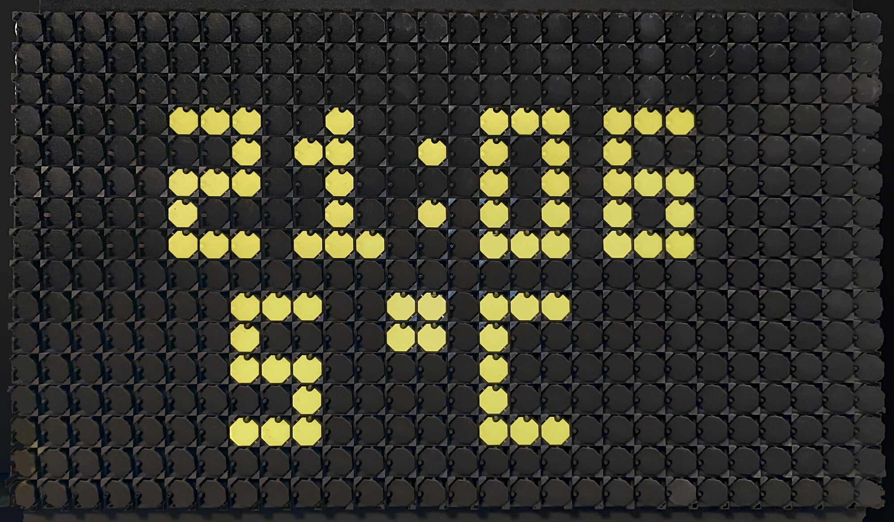
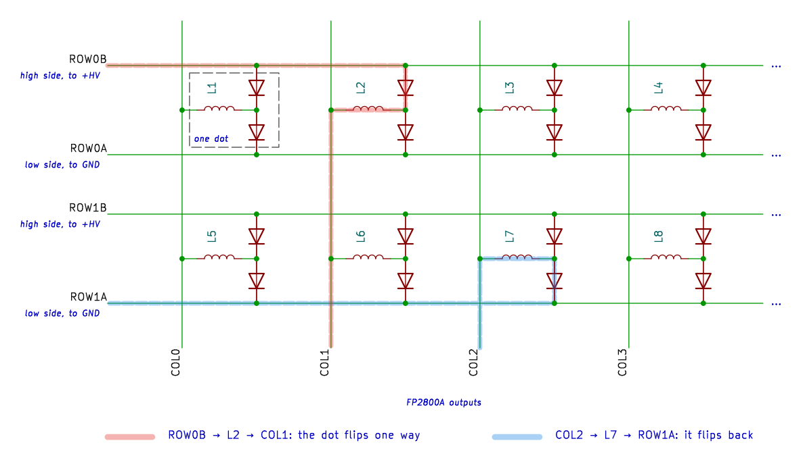
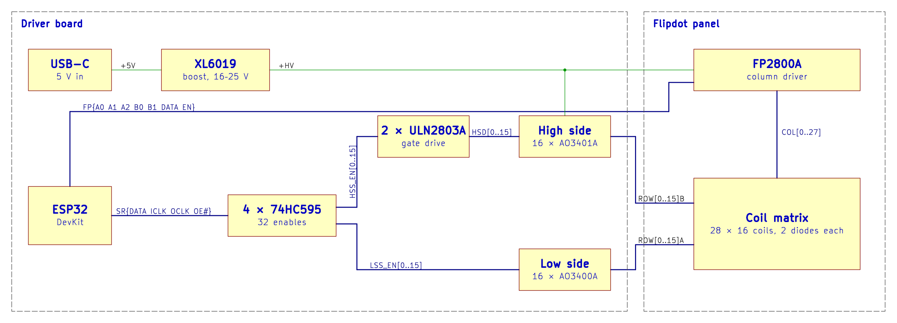
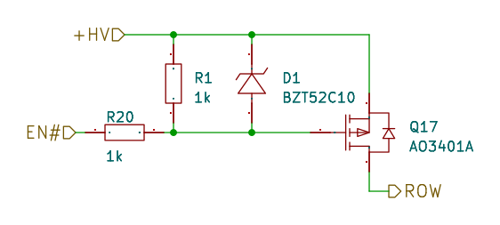

# flipdot-display

[](https://github.com/Fabus1184/flipdot-display/actions/workflows/ci.yml)

A flipdot panel driven by an ESP32. This repository includes the driver board (KiCad) and the firmware (Rust).

<p align="center">
  
  
</p>

## Repository layout

| Path                               | What                                                                                                                                                      |
| ---------------------------------- | --------------------------------------------------------------------------------------------------------------------------------------------------------- |
| [`firmware/`](firmware/)           | ESP32 firmware (Rust, `esp-hal`, bare metal)                                                                                                              |
| [`firmware/core/`](firmware/core/) | The firmware's hardware-independent part: panel driver with its safety rules, frame buffer, font, screen layout, clock discipline, parsing of network replies. A separate crate so it can be unit-tested on the PC. |
| [`hardware/`](hardware/)           | Driver board in KiCad 10: schematics, PCB, libraries, fabrication export, pinout, errata                                                                  |

## How it works

### The dots

Each [flipdot](https://en.wikipedia.org/wiki/Flip-disc_display) is a
magnetised disc on a coil. A current pulse flips it, the direction of the
current picks the colour, and the disc stays put without power.

The panel wires its 28 × 16 coils as a matrix. Each coil sits between its
column and the midpoint of two diodes, which connect to the row's two lines,
B and A. So current flows either from B through the coil into the column, or
from the column through the coil into A: one path per colour. An
[FP2800A](https://reaktor23.org/projects/flipdot/fp2800-datasheet.pdf) on the
panel connects the selected column to +HV or GND.



### The driver board



The board switches the rows and powers the panel:

- **High side:** an [AO3401A](https://www.lcsc.com/product-detail/C15127.html)
  connects `ROWnB` to +HV, its gate driven by a
  [ULN2803A](https://www.ti.com/lit/ds/symlink/uln2803a.pdf).
- **Low side:** an [AO3400A](https://www.lcsc.com/product-detail/C20917.html)
  connects `ROWnA` to GND.
- Four [74HC595](https://assets.nexperia.com/documents/data-sheet/74HC_HCT595.pdf)
  hold the 32 switch enables. An
  [XL6019](https://www.lcsc.com/datasheet/lcsc_datasheet_2309151739_XLSEMI-XL6019E1_C73018.pdf)
  boost converter makes +HV (16–25 V) from USB-C.

| High side, one row | Low side, one row |
| --- | --- |
|  |  |

### Flipping one dot

1. Latch one row switch into the shift registers (`HSS_EN_r` for one colour,
   `LSS_EN_r` for the other) and enable it with `SR_OE#`.
2. Point the FP2800A at the column with the opposite polarity and pulse
   `FP_EN` for 500 µs.
3. Switch everything off and wait 500 µs.

Never more than one row switch is on, or the FP2800A would be overloaded; the
firmware enforces and tests this ([one dot at a time](firmware/README.md#one-dot-at-a-time)).
Schematics, pinout and errata are in [`hardware/`](hardware/).

## Firmware

Rust on `esp-hal`, bare metal. Core 0 drives the panel and pulses only the dots
that change (1 ms each, so a full redraw takes 0.5 s). Core 1 runs WiFi and a
status page at `http://<board-ip>/`. What the panel shows is up to the
application; [`firmware/README.md`](firmware/README.md) describes the included
one and its settings.

Install the toolchain once:

```bash
cargo install espup espflash && espup install
```

Copy the config and fill in WiFi and the application settings:

```bash
cp firmware/config.example.toml firmware/config.toml
```

Build, flash and open the serial monitor:

```bash
source ~/export-esp.sh && cargo flash
```

| Command (top-level directory) | What |
| --- | --- |
| `cargo test`, `cargo clippy` | Host tests and lints of `firmware/core` |
| `cargo firmware`, `cargo firmware-clippy` | Build or lint the ESP32 image |
| `hardware/export.sh` | ERC, DRC, schematic parity, then PDF, BOM and Gerbers |

CI runs all of these.

## License

[CC BY-NC-SA 4.0](LICENSE): you may use, change and share everything in this
repository (firmware, hardware, documentation) for non-commercial purposes, as
long as you credit this project and share changes under the same license.
Commercial use is not allowed.

The symbols and footprints from LCSC/EasyEDA in the KiCad libraries, and the
KiCad stock symbols `TestPoint` and `PWR_FLAG`, keep their original licenses.
