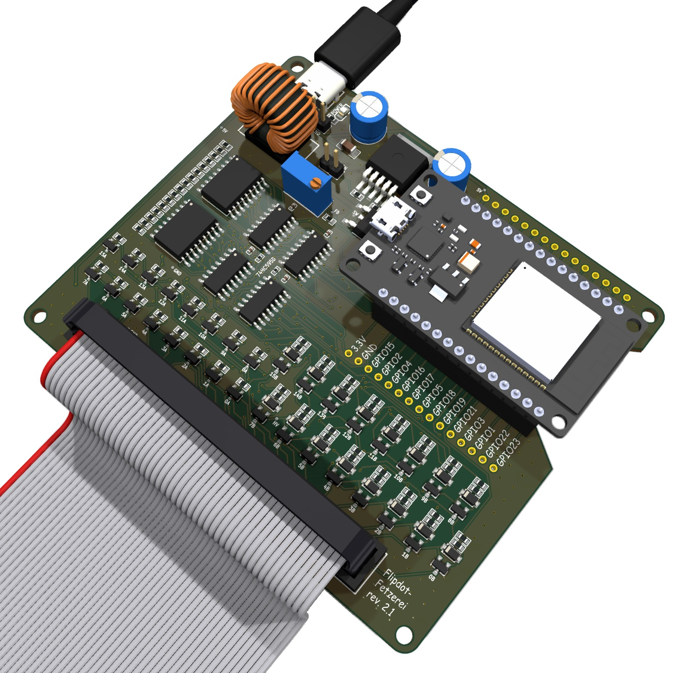
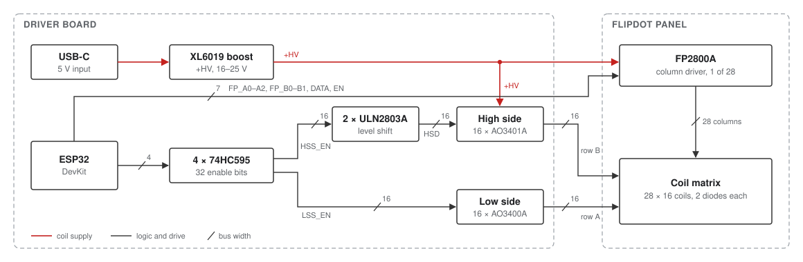
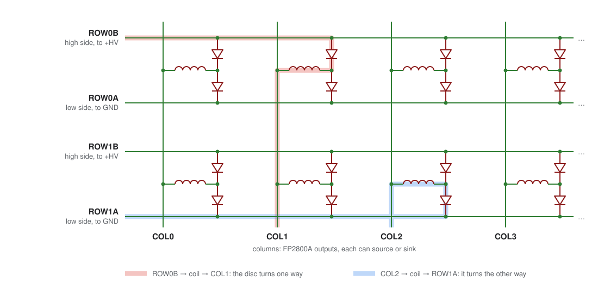
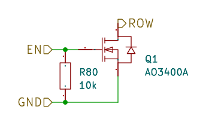

# flipdot-display

A flipdot panel driven by an ESP32. This repository includes the driver board (KiCad) and the firmware (Rust).

<p align="center">
  
  
</p>

## Repository layout

| Path                               | What                                                                                                                                                      |
| ---------------------------------- | --------------------------------------------------------------------------------------------------------------------------------------------------------- |
| [`firmware/`](firmware/)           | ESP32 firmware (Rust, `esp-hal`, bare metal)                                                                                                              |
| [`firmware/core/`](firmware/core/) | The firmware's hardware-independent part: panel driver with its safety rules, frame buffer, font, screen layout, clock discipline, parsing of network replies. A separate crate so it can be unit-tested on the PC. |
| [`hardware/`](hardware/)           | Driver board in KiCad 10: schematics, PCB, libraries, fabrication export, pinout, errata                                                                  |

## How it works



**[Flipdots.](https://en.wikipedia.org/wiki/Flip-disc_display)** Each dot is a
magnetised disc over a coil. A current pulse flips it; the current's direction
sets the colour. The disc holds its position without power.

**Panel.** The 28 × 16 coils sit in a matrix. Each row has two lines, B and A;
each coil connects its column to the midpoint of two diodes in series from B to
A. So current can only flow from row line B into the column, or from the column
into row line A. An
[FP2800A](https://reaktor23.org/projects/flipdot/fp2800-datasheet.pdf) on the
panel drives the columns: a 5-bit address selects one of the 28, and its `DATA`
input decides whether that column sources or sinks. Its output stage runs from
+HV, which it gets from the driver board.



**Driver board.** It switches the rows. Per row:

- **High side:** an [AO3401A](https://www.lcsc.com/product-detail/C15127.html)
  P-MOSFET connects `ROWnB` to +HV. A
  [ULN2803A](https://www.ti.com/lit/ds/symlink/uln2803a.pdf) channel (`HSDn`)
  pulls its gate down through a 1k/1k divider; a 10 V Zener limits the
  gate-source voltage.
- **Low side:** an [AO3400A](https://www.lcsc.com/product-detail/C20917.html)
  N-MOSFET connects `ROWnA` to GND.

The 32 enable bits (`HSS_EN_n`, `LSS_EN_n`) come from four
[74HC595](https://assets.nexperia.com/documents/data-sheet/74HC_HCT595.pdf)
shift registers. An
[XL6019](https://www.lcsc.com/datasheet/lcsc_datasheet_2309151739_XLSEMI-XL6019E1_C73018.pdf)
boost converter makes +HV (16–25 V, set with R105) from USB-C 5 V. Details are in
[`hardware/`](hardware/).

| High side, one row | Low side, one row |
| --- | --- |
|  |  |

**Flipping a dot** at row *r*, column *c*:

1. The ESP32 shifts 32 bits into the 74HC595 chain and latches them. Only
   `HSS_EN_r` or only `LSS_EN_r` is set, depending on the colour. Pulling
   `SR_OE#` low turns that one switch on: `ROWrB` is now at +HV, or `ROWrA` is
   at GND.
2. It sets the FP2800A address to column *c* and `FP_DATA` to the opposite
   direction: sink against a high-side row, source against a low-side row.
3. It raises `FP_EN` for 500 µs. Current flows through one row switch, one
   diode, the coil and the FP2800A, and the disc turns over. All other coils
   are blocked by their diodes or sit on an open column.
4. It drops `FP_EN`, raises `SR_OE#` and waits 500 µs before the next dot.

Two row switches on at once would overload the FP2800A, so the firmware makes
sure this never happens and tests it against a simulated board (see
[One dot at a time](firmware/README.md#one-dot-at-a-time)).

## Firmware

Rust on `esp-hal`, bare metal. Core 0 drives the panel and pulses only the dots
that change (1 ms each, so a full redraw takes 0.5 s). Core 1 runs WiFi and a
status page at `http://<board-ip>/`. What the panel shows is up to the
application; [`firmware/README.md`](firmware/README.md) describes the included
one and its settings.

Install the toolchain once:

```bash
cargo install espup espflash && espup install
```

Copy the config and fill in WiFi and the application settings:

```bash
cp firmware/config.example.toml firmware/config.toml
```

Build, flash and open the serial monitor:

```bash
source ~/export-esp.sh && cargo flash
```

| Command (top-level directory) | What |
| --- | --- |
| `cargo test`, `cargo clippy` | Host tests and lints of `firmware/core` |
| `cargo firmware`, `cargo firmware-clippy` | Build or lint the ESP32 image |
| `hardware/export.sh` | ERC, DRC, schematic parity, then PDF, BOM and Gerbers |

CI runs all of these.

## License

[CC BY-NC-SA 4.0](LICENSE): you may use, change and share everything in this
repository (firmware, hardware, documentation) for non-commercial purposes, as
long as you credit this project and share changes under the same license.
Commercial use is not allowed.

The symbols and footprints from LCSC/EasyEDA in the KiCad libraries, and the
KiCad stock symbols `TestPoint` and `PWR_FLAG`, keep their original licenses.
