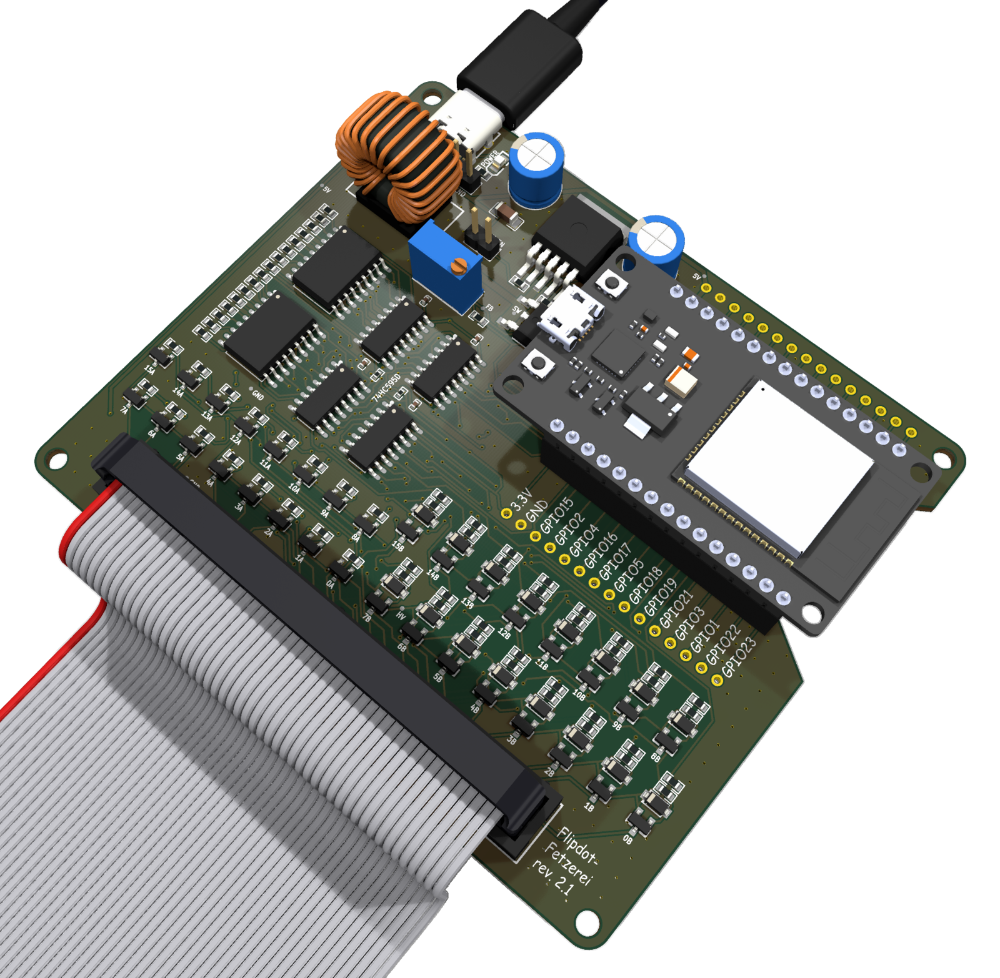
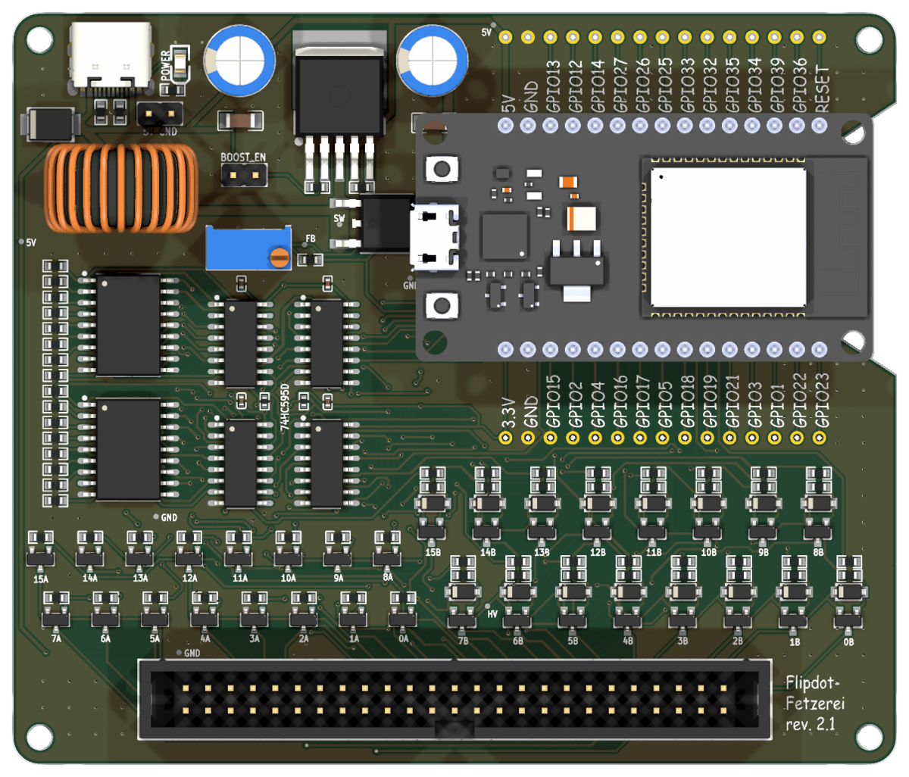
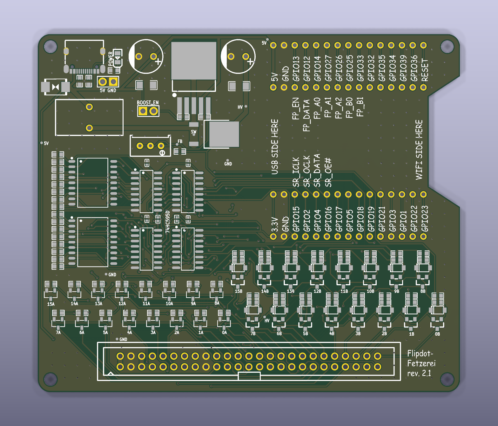
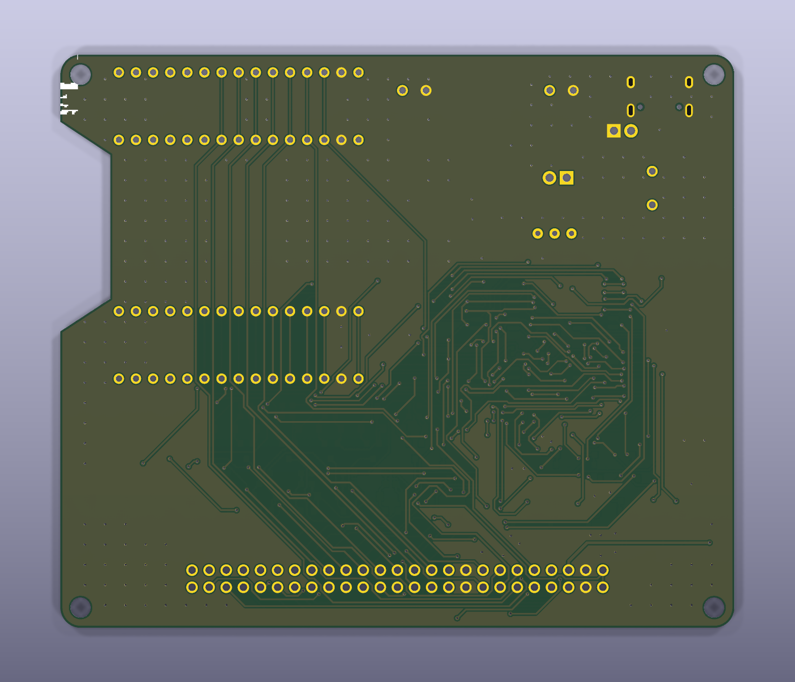
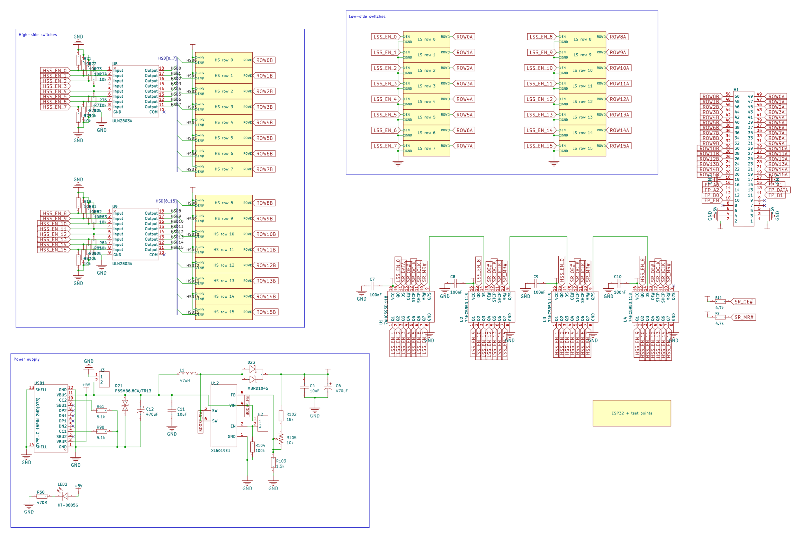
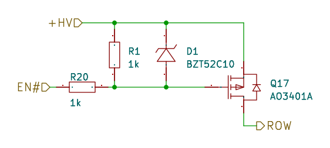
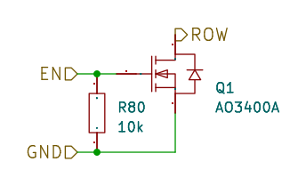
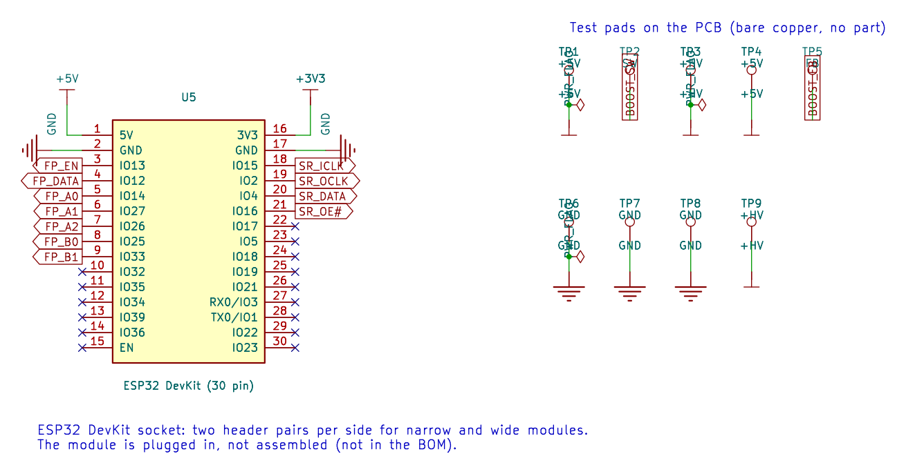
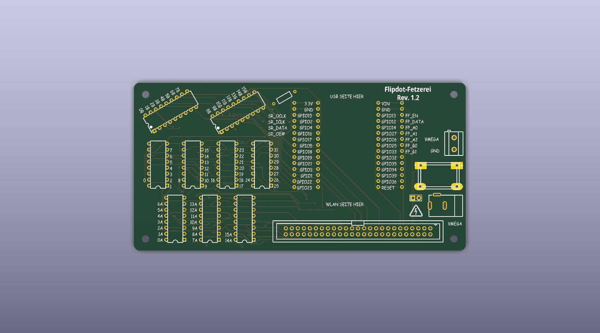

# Hardware



*KiCad render of the assembled board, including the parts JLCPCB does not
assemble: electrolytics, toroid, trimmer, headers and the ESP32 DevKit in its
sockets. USB-C and the 50-pin ribbon cable to the panel are plugged in.*

| Assembled, top | Bare board, top | Bare board, bottom |
| --- | --- | --- |
|  |  |  |

The panel is a 28 × 16 flipdot module. It carries the FP2800A column driver
and the dot coils with their diodes. The driver board here does the rest:

- row drivers for all 16 rows, in both directions;
- a socket for an ESP32 DevKit;
- a USB-C input with a boost converter for the coil voltage.

All design files are **KiCad 10** projects:

| Project | What | Status |
| --- | --- | --- |
| [`kicad/flipdot-driver/`](kicad/flipdot-driver/) | Driver board **Rev 2.1** (SMD), 100 × 85 mm, 2 layers | Current. First ordered from JLCPCB in June 2026. |
| [`kicad/flipdot-driver-rev1.2/`](kicad/flipdot-driver-rev1.2/) | Driver board **Rev 1.2** (through-hole), 140 × 71 mm | Superseded, kept for reference |
| [`kicad/panel-wiring/`](kicad/panel-wiring/) | Drawing of the panel's connector and coil/diode matrix | Documentation only, not a circuit |
| [`kicad/figures/`](kicad/figures/) | The README figures: coil matrix with current paths, block diagram | Documentation only |

Each project brings its own symbol and footprint library (`flipdot.kicad_sym`,
`flipdot.pretty/`), so it opens without extra library setup.

The projects were converted from EasyEDA Pro on 2026-11-25 (see
[History](#history)). KiCad is the source of truth from now on.

## Rev 2.1 at a glance



The top sheet has these blocks:

- **Rows.** There are 16 high-side and 16 low-side switches, one pair per row.
  Each switch type is drawn once as a sub-sheet ([`hss.kicad_sch`](kicad/flipdot-driver/hss.kicad_sch),
  [`lss.kicad_sch`](kicad/flipdot-driver/lss.kicad_sch)) and placed 16 times
  (`HS row 0…15`, `LS row 0…15`). Every placement has its own component
  references.
  - The **high-side** switches use an AO3401A P-MOSFET with a 10 V Zener gate
    clamp. Two ULN2803A arrays pull their gates.
  - The **low-side** switches use an AO3400A N-MOSFET.
- **Control.** Four 74HC595 shift registers hold one enable bit per row and
  switch direction (`HSS_EN_n`, `LSS_EN_n`). The ULN2803A outputs that drive
  the high-side gates are `HSD0`–`HSD15`.
- **Columns.** The FP2800A on the panel drives the columns. It is wired
  straight from the ESP32 through the 2 × 25 panel header H1.
- **Power.**
  - USB-C supplies 5 V. D21 is the TVS diode.
  - The XL6019 boost converter (U12) makes the coil voltage **+HV**. The
    feedback divider R102 + R105 / R103 sets it to about 16–25 V, adjustable
    with R105.
  - The `BOOST_EN` jumper (H2) enables the converter.
- **[ESP32 sheet](kicad/flipdot-driver/esp32.kicad_sch).** This sheet holds the
  ESP32 DevKit socket (U5) and the test pads TP1–TP9.
  - The socket has two header pairs per side, so it takes both narrow and wide
    30-pin DevKits.
  - The DevKit plugs in. It is not soldered, so it is not in the BOM.

| High-side switch (one channel) | Low-side switch (one channel) |
| --- | --- |
|  |  |

### ESP32 pinout



These GPIOs are on the Rev 2.1 silkscreen and are used by the firmware
([`firmware/src/main.rs`](../firmware/src/main.rs)):

| Signal | Net | GPIO |
| --- | --- | --- |
| Shift register clock | `SR_ICLK` | 15 |
| Shift register latch | `SR_OCLK` | 2 |
| Shift register data | `SR_DATA` | 4 |
| Shift register output enable (active low) | `SR_OE#` | 16 |
| FP2800A enable | `FP_EN` | 13 |
| FP2800A data (polarity) | `FP_DATA` | 12 |
| FP2800A address A0, A1, A2 | `FP_A0`–`FP_A2` | 14, 27, 26 |
| FP2800A address B0, B1 | `FP_B0`, `FP_B1` | 25, 33 |

Rev 1.2 uses the same GPIOs.

GPIO12, GPIO2 and GPIO15 are **strapping pins**. GPIO12 must be low at reset,
because high selects 1.8 V flash and the module will not boot. GPIO2 must be
low or floating to enter the serial bootloader.

## Errata of the first Rev 2.1 boards

The boards ordered in June 2026 were made from the EasyEDA layout (document
"PCB8", silkscreen "rev. n+1"). The KiCad files fix the first two items below
and drop a company logo. The silkscreen now reads "rev. 2.1", "USB SIDE
HERE" and "WIFI SIDE HERE" (DevKit orientation, German on the first boards)
and "POWER" at the LED.

1. **Known defect: the low-side MOSFET sources are not connected to GND.**
   - **What is wrong.** On these boards, the sources of Q1–Q16 and the low
     ends of their gate pull-downs sit on two isolated nets: EasyEDA's
     `$1N37900` and `$1N38170`. They belong on the real ground. Without it, the
     low-side switches cannot sink coil current.
   - **Cause.** The GND symbols for these nets were missing from the schematic
     when the PCB was laid out and ordered on 2026-06-04
     (`PCB8_20260604114714`). They were added to the schematic on 2026-06-20.
   - **Fix for an affected board.** Wire both nets to GND: pad 1 of R80 (Q1–Q7, Q14)
     and pad 1 of R5 (Q8–Q13, Q15, Q16).
   - **KiCad PCB.** Fixed: both nets are GND and connect through the ground
     pours. A board made from the KiCad files does not need the wire.
2. **USB-C shield.** On these boards the USB-C shell pads (USB1 pins 13, 14) have no
   net, while the schematic ties them to GND. The KiCad PCB follows the
   schematic.
3. **C6 / C12 value.** These capacitors are labelled 470 µF, but their LCSC
   part `UVR1H101MPD1TD` is a 100 µF / 50 V capacitor. Check what is fitted
   before reordering.

## Checks and outputs

```bash
hardware/export.sh
```

The script runs on `flipdot-driver` by default. Pass `flipdot-driver-rev1.2`
for the old board.

First it runs the checks, and it stops if one fails:

- ERC with no findings.
- DRC with no unconnected items.
- No schematic/PCB parity issues.

Then it writes these files to `kicad/<project>/output/` (git-ignored):

- the schematic as a PDF;
- the BOM with MPN and LCSC numbers;
- Gerbers and Excellon drill files as a zip;
- the placement file.

CI runs the same script, see the `hardware` job in
[`.github/workflows/ci.yml`](../.github/workflows/ci.yml).

**Known DRC findings, all on the board as manufactured:**

| Board | Silkscreen (overlap with copper/silk/edge) | Other |
| --- | --- | --- |
| Rev 2.1 | 55 | 9 edge clearances inside the LCSC USB-C footprint (its slot is 0.16 mm from the pads), 4 courtyard overlaps |
| Rev 1.2 | 175 | – |

The routing uses EasyEDA's 4 mil (0.1 mm) clearance. The net classes keep that
value, so the existing tracks pass.

**3D models.** Most parts use KiCad's official 3D library
(`${KICAD10_3DMODEL_DIR}`). It ships with KiCad's 3D package; on Arch that is
`kicad-library-3d`. Two models have no public equivalent and are bundled in
`kicad/flipdot-driver/flipdot.3dshapes/`: the toroid inductor and the ESP32
DevKit. See [`tools/3d-models/`](tools/3d-models/) for how they were placed and
which parts are approximations. Rev 1.2 has no 3D models.

The assembled renders above use a detailed third-party DevKit model and 3M's
model of the 50-pin ribbon plug (3425-6650); the cables were modelled only for
the render. None of these are in this repository, so in KiCad you see the
simplified bundled DevKit and no cables.

## History

The board was designed in EasyEDA Pro and converted to KiCad on 2026-11-25.
The original EasyEDA project is not published. KiCad cannot read its `.epro2`
format, so the
[migration tools](tools/easyeda-migration/) convert it in three steps:

1. Turn it into the older `.epro` format.
2. Run KiCad's own importer on that file.
3. Rebuild what the importer cannot do:
   - the hierarchical sheets;
   - the bus lines;
   - the DevKit socket and test pads, which were EasyEDA free pads;
   - the mounting holes;
   - the net names;
   - the links between PCB and schematic.

A re-run reproduces the same netlists.


